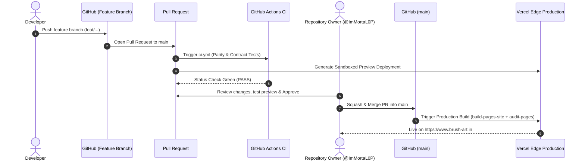

# Brush — Comprehensive Developer Technical Manual

This document provides an exhaustive technical specification of the **Brush** e-commerce platform. It details the underlying architectural patterns, technology stack, directory structure, asset inventories, multi-tiered compression strategies, hosting and deployment pipelines, pricing formulas, database schemas, and developer workflows.

---

## Table of Contents

1. [Architectural Overview & Design Philosophy](#1-architectural-overview--design-philosophy)
2. [Full Technology Stack](#2-full-technology-stack)
3. [Compression Engineering & Asset Optimization](#3-compression-engineering--asset-optimization)
4. [Asset Inventory & Quantitative Metrics](#4-asset-inventory--quantitative-metrics)
5. [Project Structure & Annotated File Reference](#5-project-structure--annotated-file-reference)
6. [Hosting, CI/CD & Deployment Pipelines](#6-hosting-cicd--deployment-pipelines)
7. [Database Architecture & MongoDB Schemas](#7-database-architecture--mongodb-schemas)
8. [Authoritative Pricing & Product Type Engine](#8-authoritative-pricing--product-type-engine)
9. [Augmented Reality (AR) & 3D Wall Studio Engine](#9-augmented-reality-ar--3d-wall-studio-engine)
10. [REST API Specification (44 Endpoints)](#10-rest-api-specification-44-endpoints)
11. [Security, Cryptography & Compliance](#11-security-cryptography--compliance)
12. [Verification, Testing & Diagnostics](#12-verification-testing--diagnostics)
13. [Operational Runbook & Maintenance Scripts](#13-operational-runbook--maintenance-scripts)

---

## 1. Architectural Overview & Design Philosophy

The Brush platform is constructed as a decoupled, headless e-commerce system optimized for high conversion, instant page rendering, and immersive visual merchandising:

```
┌────────────────────────────────────────────────────────┐
│             EDGE CACHE / CDN (Pages & Vercel)          │
│   Precompressed HTML, CSS, JS, WebP, Fonts, USDZ       │
└──────────────────────────┬─────────────────────────────┘
                           │ Static File Requests
                           ▼
┌────────────────────────────────────────────────────────┐
│             STOREFRONT CLIENT (Vanilla SPA)            │
│   • HTML5, CSS Variables, ES6 Modules / IIFE           │
│   • Apple AR Quick Look / WebXR 3D Studio Engine       │
│   • Client-Side State & LocalStorage Cart System       │
└──────────────────────────┬─────────────────────────────┘
                           │ JSON REST APIs (CORS)
                           ▼
┌────────────────────────────────────────────────────────┐
│             EXPRESS BACKEND ENGINE (Node 20)           │
│   • Authoritative Pricing Engine (productTypes.js)     │
│   • RBAC Admin Authentication & Session Management     │
│   • Payment Gateway Signature Verification             │
│   • Automated PDF Invoicing & SMTP Transactional Mail  │
│   • Qikink Print-on-Demand Dropshipping Integration    │
└────────────┬─────────────┬─────────────┬───────────────┘
             │             │             │
             ▼             ▼             ▼
      ┌────────────┐ ┌───────────┐ ┌───────────┐
      │  MongoDB   │ │  Firebase │ │ External  │
      │   Atlas    │ │  Storage  │ │ Gateways  │
      └────────────┘ └───────────┘ └───────────┘
```

### Core Design Foundations

1. **Zero Client Runtime Overhead**: The storefront avoids heavy frontend frameworks (React, Vue, or Angular). By utilizing pure Vanilla JavaScript and native Web Components (`<global-navbar>`, `<global-footer>`, `<site-overlays>`), the client executes without virtual DOM reconciliation, shipping sub-second Time to Interactive (TTI) and First Contentful Paint (FCP).
2. **Preventing Flash of Unstyled Content (FOUC)**: `theme.js` executes synchronously before the DOM paints, checking `localStorage` and system media preferences (`prefers-color-scheme`) to apply `data-theme="dark"` immediately.
3. **Single Source of Truth for Pricing**: Order calculations, discounts, variant surcharges, and taxes are strictly calculated and validated server-side in `Backend/productTypes.js`. Client-side prices submitted in requests are ignored, preventing tampering.
4. **Resilient Clean-Route Artifact Building**: Source HTML files remain flat in `public/` for straightforward local editing. The build pipeline (`tools/build-pages-site.js`) compiles clean directory routes (`/shop/index.html`, `/reels/index.html`, `/build-pack/index.html`) while auto-generating canonical tags, JSON-LD schemas, and Open Graph tags.

---

## 2. Full Technology Stack

### Storefront (Frontend)
- **Runtime Environment**: Standard evergreen web browsers (Mobile & Desktop Safari, Chrome, Edge, Firefox).
- **Core Languages**: HTML5, Modern CSS3 (CSS Custom Properties, Flexbox, Grid, BEM naming conventions), Vanilla JavaScript (ES6+ Modules, closures, IIFE).
- **Smooth Motion & Physics**: [Lenis](https://github.com/darkroomengineering/lenis) (Smooth Momentum Scroll), custom cursor follower with damping physics, magnetic CTA button attractions (`micro-interactions.js`).
- **3D & Augmented Reality**:
  - **iOS**: Apple AR Quick Look via native `<a rel="ar">` delivery of `.usdz` models.
  - **Android / Desktop**: WebXR Device API (`immersive-ar` session with vertical plane hit testing) and 3D Canvas Studio fallback.
- **Typography**: Self-hosted custom web fonts (`.woff2`, `.woff`, `.otf`, `.ttf`) loaded with `font-display: swap`.

### Application Server (Backend)
- **Runtime**: Node.js `20.x` LTS.
- **HTTP Server**: Express.js `4.18.2`.
- **Database Driver**: MongoDB Native Driver `7.5.0` (utilizing connection pooling and atomic update operators).
- **Security & Hardening**:
  - `helmet` `8.3.0` (Content Security Policy, frameguard, XSS protection).
  - `express-rate-limit` `8.6.2` (IP-based sliding window rate limits on authentication, coupon validation, and payment orders).
  - `bcryptjs` `3.0.3` (10-round salted password hashing).
- **File Handling & Cloud Storage**:
  - `multer` `2.2.0` (Multipart form-data parsing for admin image uploads).
  - `firebase-admin` `14.2.0` & `@google-cloud/storage` `8.2.0` (Cloud image asset persistence).
- **Invoicing & Communication**:
  - `pdfkit` `0.19.1` (Vector-based automated tax invoice PDF generation).
  - `nodemailer` `10.0.9` (Transactional emails via SMTP / Resend).
- **Virtual DOM / Parsing**: `jsdom` `30.0.1` (Server-side HTML parsing and email markup preparation).

### Integrations & Gateways
- **Payment Gateways**:
  - **Razorpay**: Node SDK `razorpay` `2.9.8`, REST order creation, client checkout modal, webhook listeners with HMAC-SHA256 signature verification.
  - **Cashfree**: SDK `cashfree-pg` `6.0.6`, fallback/alternative gateway.
  - **Direct Pay**: Manual UPI Intent / QR code settlement flow with backend payment confirmation and admin exception handling.
- **Dropshipping & Print-on-Demand**:
  - **Qikink API**: Custom integration client (`Backend/qikink.js`, `Backend/qikink-map.js`) for automated order fulfillment, SKU mapping, and tracking number webhooks.

### Tooling & Build Environment
- **Node.js**: Native `zlib` for static Brotli and Gzip precompression.
- **Python 3**: `Pillow` (PIL) library for Lanczos downsampling, responsive WebP generation, and wallpaper room mockups.
- **Google `cwebp`**: High-performance native WebP encoder CLI.

---

## 3. Compression Engineering & Asset Optimization

The Brush repository implements four distinct compression layers to minimize network payload, reduce CDN costs, and maintain instant page loads.

```
┌────────────────────────────────────────────────────────────────────────┐
│                   BRUSH 4-TIER COMPRESSION ARCHITECTURE                │
├─────────────────────────┬──────────────────────────────────────────────┤
│ 1. Static Precompression│ Brotli (.br, quality 4) + Gzip (.gz, level 6) │
│    (Build Step)         │ All HTML, CSS, JS, JSON, XML, SVG > 256 bytes │
├─────────────────────────┼──────────────────────────────────────────────┤
│ 2. Dynamic HTTP Stream  │ Express compression() middleware             │
│    (API Responses)      │ Dynamic gzip/deflate on all REST JSON routes  │
├─────────────────────────┼──────────────────────────────────────────────┤
│ 3. Multi-Tier WebP      │ w480 (80-82q, Lanczos) + w1080 (85q, Lanczos)│
│    (Image Pipeline)     │ Alpha channel matting + EXIF normalization   │
├─────────────────────────┼──────────────────────────────────────────────┤
│ 4. 3D USDZ Compression  │ Zero-dependency compressed ZIP container     │
│    (AR Visualizer)      │ Metric geometry + clamped embedded textures  │
└─────────────────────────┴──────────────────────────────────────────────┘
```

### Layer 1: Static Asset Precompression (Build Step)
Executed automatically by `tools/build-pages-site.js` during production builds. Every static asset exceeding 256 bytes is analyzed, compressed, and written as sidecar files:

- **Brotli (`.br`)**:
  - Engine: Node.js native `zlib.brotliCompressSync`
  - Parameters: `zlib.constants.BROTLI_PARAM_QUALITY = 4` (calibrated for high compression ratio without excessive build times).
- **Gzip (`.gz`)**:
  - Engine: Node.js native `zlib.gzipSync`
  - Compression Level: `6` (standard balanced production deflate).
- **Target Extensions**: `.html`, `.css`, `.js`, `.json`, `.xml`, `.svg`, `.txt`.
- **Serving Mechanism**: Vercel edge proxies inspect the client's `Accept-Encoding: br, gzip` header and serve precompressed binaries directly without runtime CPU overhead.

### Layer 2: Dynamic Server-Side HTTP Compression
In `Backend/server.js`, the Express app mounts dynamic compression:

```javascript
const compression = require('compression');
app.use(compression());
```

- **Scope**: Applied to all 44 JSON REST API routes (including `/api/products`, `/api/orders`, `/api/pricing`).
- **Benefit**: Compresses the product catalog response from ~380 KB of uncompressed JSON down to ~45 KB (an ~88% reduction in transfer payload).

### Layer 3: Responsive Multi-Tier Image Compression Pipeline
Images are the heaviest portion of an art store. Brush uses a dual pipeline (`tools/make-thumbs.py` and `tools/generate-all-thumbnails.js`) to generate multi-tier responsive WebP derivatives:

```
Source Images (JPG/PNG/WebP in assets/, posters/, uploads/)
                          │
         ┌────────────────┴────────────────┐
         ▼                                 ▼
   w480 Derivatives                 w1080 Derivatives
   • 480px width max                • 1080px width max
   • Lanczos resampling             • Lanczos resampling
   • WebP Quality 80-82             • WebP Quality 85
   • Target: Mobile / Card Grids    • Target: Desktop / Modals / Zoom
```

#### Pipeline Technical Specifics:
1. **Lanczos Downsampling**: Python's `Image.LANCZOS` filter is utilized to preserve line art crispness and high-frequency typography details without introducing ringing artifacts.
2. **Alpha Flattening (Matting)**: Images formatted as `RGBA`, `LA`, or `P` palette modes are converted with an alpha mask paste onto a clean `RGB` white background (`(255, 255, 255)`), preventing dark halo artifacts when rendered against light UI themes.
3. **EXIF Transposition**: `ImageOps.exif_transpose` inspects camera orientation tags and rotates images prior to compression, avoiding rotated previews on iOS photo uploads.
4. **Backend In-Place Optimizer (`Backend/compress_images.py`)**: Traverses image directories, identifies assets larger than 0.5 MB, and re-encodes them in place with PIL `optimize=True`.
5. **Wallpaper Scene Compositing (`tools/make-wallpaper-assets.py`)**: Converts raw wallpaper patterns into 4:5 living room mockups (1600×2000 px) with 2× supersampling (`SS=2`), room lighting masks, cushion accent-tinting, and 1:1 print-scale zoom crops.

### Layer 4: 3D AR Model Packaging (`.usdz`)
Apple AR Quick Look requires USDZ archives (`model/vnd.usdz+zip`). The engine (`public/ar-view.js`):
- Packages USDA scene descriptions with zero-compression store headers or standard deflate algorithms.
- Dynamically resizes poster textures to powers of two (e.g., 1024×1024 or 2048×2048) before streaming to iOS Safari, maintaining low RAM usage on mobile GPUs.

---

## 4. Asset Inventory & Quantitative Metrics

A full structural audit of tracked project assets reveals the following exact counts and distributions:

### High-Level Summary
- **Total Project Tracked Files**: **2,932 files** (~1,584.87 MB).
- **Frontend Storefront Files (`public/`)**: **2,751 files** (~1,523.22 MB).
- **Backend Application (`Backend/` clean)**: **52 files** (~0.81 MB without `node_modules`).
- **Tooling & Build Suite (`tools/`)**: **28 files** (~1.06 MB).
- **Stickers & Marketing Vector Pack (`stickers/`)**: **50 files** (~37.26 MB).
- **Catalog Database Records (`products_and_posters.csv`)**: **384 products** mapped across 20 distinct categories.

### Breakdown of File Types (`public/`)
| File Extension | Count | Primary Purpose |
| :--- | :--- | :--- |
| `.webp` | 2,215 | Responsive image derivatives (`w480`, `w1080`), banners, and category previews |
| `.jpg` / `.jpeg` | 232 | High-resolution master room mockups, source wallpapers, and hero photography |
| `.png` | 219 | Transparent apparel mockups, sticker sheets, and UI icons |
| `.js` | 23 | Client scripts, UI web components, state controllers, and physics engines |
| `.html` | 17 | Core storefront pages, customer account views, checkout, and admin suites |
| `.svg` | 10 | Crisp vector icons, brand logos, and status indicators |
| `.woff2` / `.woff` / `.otf` / `.ttf` | 16 | Self-hosted typography (Brush brand fonts in `public/Fonts/`) |
| `.zip` | 6 | High-resolution digital downloads and printable sticker bundles |
| `.css` | 4 | Global design system (`styles.css`), store catalog (`store.css`), admin (`admin.css`), reels (`reels.css`) |
| `.json` / `.xml` / `.txt` | 7 | Site configs, `sitemap.xml`, `robots.txt`, `llms.txt` |
| `.gif` | 2 | Animated UI loaders and interaction previews |

### Responsive Derivative Inventory (`public/img/`)
- Total files: **1,889 files** (110.69 MB).
- **`public/img/w480/`**: **785 WebP files** (width capped at 480px, quality 80-82).
- **`public/img/w1080/`**: **785 WebP files** (width capped at 1080px, quality 85).
- Root / Site graphics (`public/img/site/`): Vector SVGs, default Open Graph banners, logos, and UI markers.

### Media Catalog Breakdown (`public/assets/`)
Total files: **354 files** (1,312.06 MB) distributed across 22 catalog folders:

| Category Folder | File Count | Media Formats & Content |
| :--- | :---: | :--- |
| `DigitalAssets` | 47 | High-res printable vectors, architecture art, download previews |
| `Hoodies` | 29 | Mockups, front/back cuts, fabric textures |
| `Pop Culture` | 27 | Anime, gaming, cinema, and retro illustrations |
| `Typography` | 26 | Hand-lettered art prints, motivational quotes |
| `Figurines` | 24 | Collectible art figurines and display photography |
| `Tshirt designs` | 24 | Apparel graphics, sizing guides, model previews |
| `Stickers` | 23 | Die-cut sticker sheets and individual mockup assets |
| `Travel` | 20 | Travel posters, architectural photography, cityscapes |
| `Wallpapers` | 18 | Seamless pattern tiles, room settings, 1:1 texture details |
| `MetalPosters` | 24 Anime metal renders + 1 satin aluminium texture | Source artwork shown clean in product hover and gallery |
| `misc` | 13 | Badges, new arrival banners, graphic accents |
| `Tapestry` | 12 | Woven wall tapestries, bedroom hanging mockups |
| `Floral` | 12 | Botanical and wildflower fine art prints |
| `Wall Setup Packs` | 11 | Complete collage wall sets (e.g., Music Set, Indie Set) |
| `Sports` | 10 | Football, basketball, and athlete tribute posters |
| `Mythological` | 9 | Ancient folklore, cultural deities, and historic prints |
| `F1` | 8 | Formula 1 team, driver, and circuit illustrations |
| `custom_prints` | 6 | Personalized print templates and canvas guides |
| `wall_setups` | 6 | Multi-frame wall collage lifestyle renders |
| `Motivation` | 5 | Minimalist office and workspace art |
| `categories` | 4 | High-level storefront category thumbnail cards |
| `hero` | 3 | High-impact homepage carousel background banners |

### Print Art Master Artwork (`public/posters/`)
- **384 files** (87.46 MB) containing high-resolution source posters, curated pack collections (Artist Packs, Anime Packs, Minimalist Sets), and printable multi-sheet formats.

---

## 5. Project Structure & Annotated File Reference

### Root Directory
- `package.json`: Main manifest configuring scripts (`test`, `dev:frontend`, `dev:backend`, `audit:pages`, `migrate:poster-prices`).
- `DEVELOPER.md`: This comprehensive developer specification manual.
- `README.md`: Flagship presentation and quickstart guide.
- `vercel.json`: Vercel Edge configuration declaring clean URL 301 redirects, security headers, and static caching lifetimes.
- `keepalive.sh`: Cron-compatible shell script executing curl health pings against the Render backend.
- `products_and_posters.csv`: Authoritative CSV catalog of 384 products with pricing, dimensions, and category tags.

### Frontend Application (`public/`)
- **Core Pages**:
  - `index.html`: Storefront homepage featuring responsive hero banners, category grids, bestselling art carousels, and new arrivals.
  - `all_products.html`: Dynamic catalog page (`/shop/`) supporting multi-facet filtering (category, product type, price range, orientation, search query).
  - `poster-reels.html`: Vertical mobile-first swipeable reels feed (`/reels/`) with continuous scroll and instant double-tap cart interactions.
  - `build-pack.html`: Custom collage pack builder (`/build-pack/`) for 3, 5, 10, 15, 20, and 25-poster gallery sets with dynamic discount tiers.
  - `digital-assets.html`: Digital artwork download showcase (`/buy-digital-assets/`).
  - `checkout.html`: Multi-step checkout pipeline supporting shipping address entry, coupon code validation, and payment provider selection.
  - `order-confirmation.html`: Post-checkout summary with real-time order status and direct PDF invoice download links.
  - `admin.html`: Dedicated administrative portal with role-based feature gating.
  - `about_us.html`, `institutional.html`, `special_day.html`, `style_options.html`, `policies.html`, `maintenance.html`, `404.html`: Informational and legal subpages.
- **JavaScript Controllers & Modules**:
  - `script.js`: Global UI controller handling user authentication modals, account profile drawers, toast messaging, and product detail modal dialogs.
  - `store.js`: Catalog controller for `/shop/`; manages URL search parameters, filter state machines, sorting, and dynamic grid rendering.
  - `cart.js`: Authoritative client-side cart library storing line items in `localStorage`, computing variant price deltas, and enforcing promo rules.
  - `ar-view.js`: Augmented Reality & 3D Wall Studio Engine (Apple AR Quick Look, WebXR Immersive AR, and 3D Canvas Studio fallback).
  - `global-navbar.js`: Native Custom Element (`<global-navbar>`) rendering the adaptive header, search bar, and cart badge across all views.
  - `global-footer.js`: Native Custom Element (`<global-footer>`) rendering site links, copyright, and institutional disclosures.
  - `site-overlays.js`: Native Custom Element (`<site-overlays>`) providing shared search dialogs, auth modals, product overlays, and cart drawers.
  - `theme.js`: Instant light/dark theme switcher executed before first paint.
  - `scroll.js`: Smooth momentum scrolling initialized via Lenis with accessibility checks for `prefers-reduced-motion`.
  - `micro-interactions.js`: Smooth cursor follower with physical spring damping and magnetic attraction on interactive CTA buttons.
  - `img-utils.js`: Helper module (`BrushImg`) resolving responsive WebP URLs across `w480` and `w1080` folders with original fallback handling.
  - `search-core.js`: Client-side fuzzy search indexing product titles, tags, and categories.
  - `admin.js`: Administrative portal controller powering inventory updates, order fulfillment, pricing controls, and audit log inspection.
- **Styling Architecture**:
  - `styles.css`: Master design system defining global CSS variables (colors, typography, elevation shadows, borders, transitions) and responsive breakpoints.
  - `store.css`: Specialized styles for catalog faceted filter drawers, search bars, and product cards.
  - `reels.css`: Full-screen vertical snapping styles and touch controls for the Reels view.
  - `admin.css`: Clean, utilitarian styling for the admin dashboard, data tables, and metrics widgets.

### Backend Application (`Backend/`)
- `server.js`: Central Express server application (~3,415 lines of code) exposing 44 REST endpoints, managing database connections, and orchestrating business logic.
- `productTypes.js`: Server-side pricing engine defining variant groups, base rates, GST rules, and packaging fees.
- `invoiceTemplate.js`: Vector PDF generator utilizing PDFKit to produce branded tax invoices complete with itemized charges and QR verification.
- `orderEmailTemplate.js`: Responsive HTML and plain-text transactional email templates dispatched via Nodemailer.
- `setupAdmin.js`: Command-line interface for provisioning admin accounts with bcrypt-hashed credentials.
- `qikink.js`: Integration client for the Qikink Print-on-Demand REST API.
- `qikink-map.js`: Mapping tables converting internal Brush product types and sizes into Qikink vendor SKUs.
- `compress_images.py`: Pillow-powered image optimizer for backend storage directories.
- `tests/charges-parity.js`: Automated parity test verifying mathematical agreement between client and server pricing engines.
- `tests/ar-poster-contract.js`: Contract test validating physical AR metric sizing and Apple Quick Look compatibility.
- `scripts/`: Collection of migration and maintenance scripts (e.g., `seed_new_categories.js`, `set-poster-original-price.js`).

### Tooling Suite (`tools/`)
- `build-pages-site.js`: Compiles flat HTML files into clean-route directory indexes (`.pages-site/`), injects SEO tags, and generates Brotli/Gzip precompressed assets.
- `audit-pages.js`: Automated CI auditor validating route completeness, single H1 tags, canonical tags, JSON-LD validity, and legacy link elimination.
- `make-thumbs.py`: Multi-tier responsive WebP thumbnail generator using Python PIL.
- `generate-all-thumbnails.js`: High-speed derivative generator utilizing native `cwebp`.
- `sync-cart-config.py`: Syncs pricing rules from `Backend/productTypes.js` into `public/cart.js`.
- `site-config.js`: Central definition of canonical origins (`https://www.brush-art.in`).
- `make-wallpaper-assets.py`: Generates living room scene mockups and detail crops for wallpaper products.
- `collection-pages.js` & `product-pages.js`: Generates static SEO landing pages for individual products (`/p/<id>-<slug>/`) and collections.

---

## 6. Hosting, CI/CD & Deployment Pipelines

### Frontend Production Deployment (Vercel)

The live production storefront (`https://www.brush-art.in`) is deployed and hosted on **Vercel**:
- **Configuration**: [`vercel.json`](vercel.json)
- **Build & Quality Pipeline**:
  ```bash
  node tools/build-pages-site.js .pages-site && node tools/audit-pages.js .pages-site
  ```
- **Output Directory**: `.pages-site`



#### Vercel Production Build Lifecycle:
1. **Compilation**: `node tools/build-pages-site.js .pages-site` compiles flat HTML source files into clean directory index routes (`/shop/index.html`, `/reels/index.html`, `/build-pack/index.html`).
2. **SEO Route Audit**: `node tools/audit-pages.js .pages-site` scans every generated route to guarantee strict SEO invariants: exactly one `<h1>` per indexable page, presence of canonical `<link>` tags, Open Graph meta tags, JSON-LD structured schemas, and zero broken legacy links. If any invariant fails, Vercel immediately aborts the deployment.
3. **Precompression**: Generates `.br` (Brotli quality 4) and `.gz` (Gzip level 6) companion files for all assets >256 bytes for edge delivery.
4. **Clean Redirects & Edge Routing**: Configures 301 permanent redirects routing legacy `.html` requests to clean paths.
5. **Edge Cache Headers**:
   - Static Media (`/img/`, `/assets/`, `/posters/`, `/Fonts/`): `Cache-Control: public, max-age=31536000, immutable` (1 year cache).
   - Dynamic Scripts & Styles (`*.js`, `*.css`): `Cache-Control: public, max-age=86400, stale-while-revalidate=604800` (1 day cache with 7-day stale-while-revalidate).
   - 3D USDZ Models (`*.usdz`): `Content-Type: model/vnd.usdz+zip` with 1-day edge caching.
   - Crawl Manifests (`sitemap.xml`, `robots.txt`, `llms.txt`): 1-hour cache with 1-day stale-while-revalidate.
6. **Hardened Edge Security Headers**: Injects HSTS, CSP, nosniff, frameguard, and cross-origin isolation.

### Branch Protection & Deployment Governance

To ensure other developers cannot push or deploy unauthorized changes directly:
1. **Mandatory Code Ownership (`.github/CODEOWNERS`)**:
   `@ImMortaL0P` is declared the universal code owner for the entire repository (`* @ImMortaL0P`). All PRs require explicit approval from the repository owner before GitHub allows a merge.
2. **Automated CI Quality Gate (`.github/workflows/ci.yml`)**:
   Every pull request automatically executes `npm test` (`charges-parity.js` and `ar-poster-contract.js`). Merging is blocked if tests fail.
3. **Vercel Preview Isolation**:
   Pull requests generate preview deployments for visual QA without impacting production. Production deployment occurs exclusively when `@ImMortaL0P` merges the PR into `main`.

### Backend Deployment (Render Web Service)

- **Target Platform**: Render (Node 20 environment) or containerized Linux VM.
- **Start Command**: `node server.js` (working directory `Backend/`).
- **Warm-Window & 24/7 Keepalive System**:
  Free tier Render container instances enter sleep mode after 15 minutes of inactivity (causing ~50-90s cold start delays). Render grants 750 free instance hours per month — because a full 31-day month is 744 hours (31 × 24), a single active service can run 24/7 without exceeding free quotas:
  1. **External Monitors (Recommended)**: Set up a free monitor (e.g. UptimeRobot or Cron-job.org) pinging `https://brush-production.onrender.com/api/health` every 5–10 minutes.
  2. **GitHub Actions Cron ([`.github/workflows/keepalive-render.yml`](.github/workflows/keepalive-render.yml))**: Automated 10-minute scheduled workflow pinging `/api/health` 24/7.
  3. **Local Shell Script (`keepalive.sh`)**: Runs a looping 10-minute keepalive daemon from a local terminal or workstation.

---

## 7. Database Architecture & MongoDB Schemas

The application connects to **MongoDB Atlas** using the official `mongodb` driver. Database collections and document structures are detailed below:

### Collections Schema Reference

#### 1. `products`
```json
{
  "_id": "ObjectId('...')",
  "id": "poster_101",
  "name": "Astronaut in the Ocean",
  "slug": "astronaut-in-the-ocean",
  "category": "Space & Sci-Fi",
  "productType": "poster",
  "price": 299,
  "originalPrice": 499,
  "description": "Museum-grade art print featuring vibrant archival pigments.",
  "image": "assets/Space/astronaut.jpg",
  "images": [
    "assets/Space/astronaut.jpg",
    "assets/Space/astronaut_mockup.jpg"
  ],
  "stock": 100,
  "featured": true,
  "bestseller": true,
  "tags": ["space", "astronaut", "minimalist", "sci-fi"],
  "rating": 4.9,
  "reviewCount": 18,
  "createdAt": "ISODate('2026-01-15T10:00:00Z')"
}
```

#### 2. `orders`
```json
{
  "_id": "ObjectId('...')",
  "orderId": "ORD-2026-10492",
  "customer": {
    "name": "Aarav Sharma",
    "email": "aarav@example.com",
    "phone": "+919876543210"
  },
  "shippingAddress": {
    "street": "42 Indiranagar 100ft Road",
    "city": "Bengaluru",
    "state": "Karnataka",
    "pincode": "560038",
    "country": "India"
  },
  "items": [
    {
      "productId": "poster_101",
      "name": "Astronaut in the Ocean",
      "productType": "poster",
      "quantity": 2,
      "price": 299,
      "variants": { "size": "A3", "gsm": "300", "finish": "matte" }
    }
  ],
  "charges": {
    "subtotal": 598,
    "discount": 50,
    "shipping": 0,
    "tax": 83.60,
    "total": 548
  },
  "payment": {
    "method": "razorpay",
    "status": "paid",
    "razorpayOrderId": "order_XXXXX",
    "razorpayPaymentId": "pay_XXXXX",
    "paidAt": "ISODate('2026-10-24T12:30:00Z')"
  },
  "fulfillment": {
    "status": "processing",
    "carrier": "BlueDart",
    "trackingNumber": "BD84920412",
    "qikinkOrderId": "QK-92144"
  },
  "invoiceNumber": "INV-2026-0812",
  "createdAt": "ISODate('2026-10-24T12:28:00Z')"
}
```

#### 3. `admins` & `admin_logs`
- `admins`: Stores username, bcrypt-hashed password, assigned role (`superadmin`, `stocker`, `watcher`), and active session tokens with 12-hour TTLs.
- `admin_logs`: Comprehensive audit trail recording every administrative modification (price change, product deletion, stock adjustment, fulfillment update, log purge) with admin ID, action tag, IP address, and timestamp.

#### 4. `users` & `counters`
- `users`: Registered shopper accounts with hashed passwords, reset tokens, and saved addresses.
- `counters`: Atomic auto-increment sequences for sequential order numbering (`orderId`) and tax invoice numbering (`invoiceNumber`).

---

## 8. Authoritative Pricing & Product Type Engine

All product options and price deltas are governed by `Backend/productTypes.js`. The exported function `priceWithVariants(basePrice, productType, variants)` computes the final line item rate:

$$\text{Final Price} = \text{basePrice} + \sum \text{priceDelta}(\text{variants})$$

### Product Types Configuration

The engine supports 15 distinct product types:
1. `poster`: Standard individual fine art posters.
   - **Size Options**: A5 ($-30$), A4 (Base rate), A3 ($+30$), 12×18″ ($+90$), 13×19″ ($+150$).
   - **Paper GSM**: 300 GSM (Base rate), 225 GSM ($-6$), 175 GSM ($-12$).
   - **Finish**: Matte, Glossy ($0$ delta).
   - **Framing**: Unframed ($0$), Gallery Framed A5 ($+200$), A4 ($+350$), A3 ($+650$).
2. `poster_3_pack` to `poster_pack_25`: Multi-poster collage bundles with volume discounting.
3. `apparel`: Premium t-shirts (Styles: UC21 Standard or Oversized; Prints: DTF, Puff, Screen; Sizes: XS to XXL).
4. `hoodie`: Heavyweight fleece hoodies (Prints: DTF or Puff; Sizes: S to XXL).
5. `tapestry`: Woven wall hangings (Sizes: Standard, Large, Tapestry XL).
6. `metal`: High-gloss aluminum panels with magnetic mounting kits.
7. `plate`: Ceramic and melamine wall art plates (Diameters: 7″, 8″, 10″).
8. `wallpaper`: Peel-and-stick decorative rolls (Sizes: 24″×48″, 24″×96″, 24″×120″).
9. `digital`: High-resolution 300 DPI vector / printable file downloads (zero shipping, instant access).
10. `generic`: Fixed-rate gift cards and accessories.

### Charge Calculation Invariants & Parity

The full cart charging formula computes:
$$\text{Total} = \text{Subtotal} - \text{Launch Discount} - \text{Coupon Discount} + \text{Shipping} + \text{COD Fee}$$

- **Launch Discount**: ₹50 discount automatically awarded on carts $\ge ₹399$.
- **Free Shipping Threshold**: Free standard shipping for orders $\ge ₹599$. Otherwise ₹59 standard delivery fee.
- **Express & Priority Surcharges**: Express (+₹49) and Priority (+₹99) optional delivery tiers.
- **Cash on Delivery (COD) Surcharge**: Flat ₹34 handling fee applied only to physical apparel and goods; posters and digital downloads are strictly prepaid-only.
- **GST Rate**: 18% integrated goods and services tax inclusive within displayed consumer prices.

Parity between server calculations and client cart views is validated automatically via `npm test` (`Backend/tests/charges-parity.js`).

---

## 9. Augmented Reality (AR) & 3D Wall Studio Engine

The AR module (`public/ar-view.js`) enables shoppers to visualize wall decor at exact physical dimensions in their living space.

```
                      User Clicks "View in AR"
                                │
        ┌───────────────────────┴───────────────────────┐
        ▼                                               ▼
iOS Safari Device?                            Android / Desktop?
Supports rel="ar" & USDZ                      Supports WebXR immersive-ar?
        │                                               │
   ┌────┴────┐                                     ┌────┴────┐
  YES        NO                                   YES        NO
   │          │                                    │          │
   ▼          ▼                                    ▼          ▼
Apple AR   3D Studio                          WebXR Plane  3D Canvas
Quick Look  Fallback                          Hit Testing   Studio
```

### 1. Apple AR Quick Look (iOS)
- **Detection**: Evaluates `document.createElement('a').relList.supports('ar')`.
- **Packaging**: Generates or routes to a `.usdz` 3D model containing nominal metric dimensions (A5: 0.148×0.210m, A4: 0.210×0.297m, A3: 0.297×0.420m).
- **Execution**: Renders natively inside iOS Quick Look with realistic environmental light reflection and real-world scale tracking.

### 2. WebXR Immersive-AR (Android & Supported Browsers)
- **Session Type**: `navigator.xr.requestSession('immersive-ar', { requiredFeatures: ['hit-test'] })`.
- **Wall Detection**: Filters hit-test results for vertical plane normals ($\pm 15^\circ$ from perpendicular) to mount posters flat against physical walls.
- **Interaction**: Single tap anchors the artwork in 3D space with continuous camera pose tracking.

### 3. 3D Room Studio Fallback (Desktop & Unsupported Devices)
- Renders an interactive 3D studio using WebGL/Canvas.
- Shoppers can toggle between four realistic frame options:
  - **Matte Black Aluminium**
  - **Natural Nordic Oak**
  - **Polished Brass**
  - **Borderless Acrylic Mount**
- Complete resource disposal on modal close prevents GPU memory leaks.

---

## 10. REST API Specification (44 Endpoints)

The Express server (`Backend/server.js`) handles 44 REST endpoints structured into operational groups:

### 1. Authentication & User Profile
- `POST /api/auth/signup`: Customer account registration (bcrypt password hashing).
- `POST /api/auth/login`: Customer authentication returning session token.
- `POST /api/auth/logout`: Invalidates customer session.
- `POST /api/auth/forgot-password`: Generates secure password reset token and sends email.
- `POST /api/auth/reset-password`: Validates reset token and updates password.
- `POST /api/auth/change-password`: Authenticated password change.
- `GET /api/auth/profile/:id`: Fetches customer profile and saved delivery addresses.
- `PUT /api/auth/profile/:id`: Updates customer profile.
- `GET /api/orders/user/:id`: Retrieves order history for a customer account.

### 2. Product Catalog & Reviews
- `GET /api/products`: Retrieves all catalog products with filtering, search, and category grouping.
- `GET /api/products/:id`: Retrieves a single product by ID or slug.
- `POST /api/products`: Admin endpoint for creating a new product with multipart image upload.
- `PATCH /api/products/:id`: Admin endpoint for updating product fields, pricing, and stock.
- `DELETE /api/products/:id`: Admin endpoint for archiving/deleting a product.
- `POST /api/products/:id/reviews`: Submits a customer product review and rating.
- `POST /api/requirements`: Handles custom print requests and bespoke design inquiries.

### 3. Checkout, Pricing & Discounts
- `GET /api/pricing`: Retrieves internal rate cards and variant surcharge tables.
- `GET /api/pricing/public`: Publicly accessible variant options and pricing rules.
- `POST /api/coupons/validate`: Validates coupon codes against order total and expiration dates.
- `GET /api/config/razorpay`: Exposes the public Razorpay Key ID.
- `GET /api/config/direct-pay`: Exposes Direct UPI transfer details (when enabled).

### 4. Payments & Webhooks
- `POST /api/payment/create-order`: Generates an official Razorpay order ID with server-verified amount.
- `POST /api/payment/cashfree/create-order`: Alternative Cashfree order session creation.
- `POST /api/payment/webhook`: Cryptographically verified webhook listener for Razorpay payment capture.
- `GET /api/payment/exceptions`: Admin endpoint to review payment discrepancies and unconfirmed orders.

### 5. Orders & Invoicing
- `POST /api/orders`: Submits and confirms an order; verifies payment signature before writing to DB.
- `GET /api/orders/:orderId`: Retrieves order status, tracking information, and line items.
- `POST /api/orders/:orderId/cancel`: Customer/admin cancellation endpoint.
- `GET /api/orders/:orderId/invoice`: Streams a dynamically generated branded PDF tax invoice (PDFKit).
- `POST /api/orders/:orderId/confirm-payment`: Admin override confirming manual UPI / direct transfers.
- `POST /api/orders/:orderId/request-payment`: Dispatches payment link reminder emails to customers.

### 6. Admin Management & Logs
- `POST /api/admin/login`: Authenticates admin users (`superadmin`, `stocker`, `watcher`).
- `POST /api/admin/logout`: Ends admin session.
- `GET /api/orders`: Retrieves full order management queue with fulfillment status filters.
- `POST /api/admin/orders`: Manual order creation by admin staff.
- `PATCH /api/orders/:orderId/status`: Updates order state (`pending`, `processing`, `shipped`, `delivered`, `cancelled`).
- `PATCH /api/orders/:orderId/tracking`: Attaches tracking number and courier carrier details.
- `POST /api/orders/:orderId/send-update`: Triggers transactional status email to customer.
- `GET /api/admin/logs`: Queries administrative audit trail logs.
- `PATCH /api/admin/logs/:id/keep`: Flags an audit log entry for permanent preservation against auto-cleanup.

### 7. Dropshipping Fulfillment (Qikink)
- `POST /api/orders/:orderId/fulfil`: Dispatches order details to Qikink POD API for automated printing and dispatch.
- `POST /api/_qikink/verify-skus`: Verifies product SKU availability against Qikink catalog.
- `GET /api/_qikink/diagnose`: Diagnostics endpoint for testing Qikink API handshake and credentials.

### 8. System Health
- `GET /api/health`: Health monitoring endpoint reporting uptime, Node version, memory usage, and MongoDB connectivity.

---

## 11. Security, Cryptography & Compliance

1. **Payment Signature Verification**:
   All Razorpay payment confirmations are cryptographically verified using HMAC-SHA256:
   $$\text{HMAC-SHA256}(\text{razorpay\_order\_id} + "|" + \text{razorpay\_payment\_id}, \text{RAZORPAY\_KEY\_SECRET})$$
   Orders are rejected with HTTP 400 if the signature fails validation.
2. **Strict NoSQL Injection Prevention**:
   Input parameters passed into MongoDB queries are validated with explicit type checks (`isNonEmptyString`, integer bounds checking). Plain user objects cannot introduce MongoDB query operators (such as `{"$gt": ""}`).
3. **Shopper Text Sanitization**:
   Customer inputs (names, shipping notes, reviews) are filtered through `cleanText()`, trimming whitespace, stripping script injection tags, and imposing strict length ceilings.
4. **Session Management & Background Sweeper**:
   - Customer tokens have a 7-day TTL.
   - Admin tokens have a 12-hour TTL.
   - An automated background sweeper executes every 15 minutes in `server.js` to purge expired sessions from memory.
5. **Rate Limiting**:
   `express-rate-limit` enforces sliding window request quotas on sensitive routes:
   - Auth endpoints (`/api/auth/*`, `/api/admin/*`): 10 requests per 15-minute window.
   - Payment order creation (`/api/payment/create-order`): 20 requests per 15-minute window.
6. **HTTP Security Headers**:
   Mounted via `helmet` across all responses with custom Content Security Policy (CSP), frameguard rules, and cross-origin isolation.

---

## 12. Verification, Testing & Diagnostics

The project maintains automated verification suites executed via standard npm scripts:

```bash
# Run unit and contract test suites
npm test
```

### Test Suite Components

1. **Charges Parity Test (`Backend/tests/charges-parity.js`)**:
   - Loads `public/cart.js` in a headless Node.js `vm` sandbox without network access.
   - Compares output against `Backend/productTypes.js` across 20+ realistic purchasing scenarios (single prints, 20-packs, hoodies, framed prints, express shipping, coupons, COD handling).
   - Enforces mathematical parity down to the cent, guaranteeing that the shopper's cart total always matches the server's final charge.
2. **AR Poster Contract Test (`Backend/tests/ar-poster-contract.js`)**:
   - Validates that all defined poster aspect ratios (A5, A4, A3, 12×18″, 13×19″) match metric physical boundaries.
   - Verifies that generated Apple AR Quick Look URLs conform to schema guidelines.
3. **SEO Route Auditor (`tools/audit-pages.js`)**:
   - Evaluates the compiled `.pages-site` output prior to production deployment.
   - Confirms:
     - Exactly one `<h1>` element per indexable page.
     - Presence of canonical `<link>` and Open Graph metadata.
     - Valid JSON-LD structured data (`Organization`, `WebSite`, `BreadcrumbList`).
     - Absolute zero orphan or broken legacy links.

---

## 13. Operational Runbook & Maintenance Scripts

### Adding New Products via CLI
To seed or batch-upload new catalog items:
```bash
# Add new poster catalog entries
node tools/add-new-posters.js

# Apply catalog overhauls from CSV
python3 tools/apply_poster_overhaul.py
```

### Synchronizing Pricing Rules
Whenever editing prices or variant deltas in `Backend/productTypes.js`, synchronize the frontend cart mirror:
```bash
python3 tools/sync-cart-config.py
npm test
```

### Regenerating WebP Responsive Thumbnails
When new art assets are added to `public/assets/` or `public/posters/`:
```bash
# Python PIL thumbnail generator (w480 and w1080)
python3 tools/make-thumbs.py

# Or high-speed native cwebp generator
node tools/generate-all-thumbnails.js
```

### Provisioning an Admin User
To provision or reset administrative access credentials:
```bash
cd Backend
SETUP_ADMIN_USERNAME=myadmin SETUP_ADMIN_PASSWORD=securepassword node setupAdmin.js
```

### Inspecting Print-on-Demand (Qikink) Integration
To test the API handshake with Qikink fulfillment servers:
```bash
# Ensure QIKINK_DIAGNOSTICS=true in Backend/.env
curl -X GET http://localhost:5500/api/_qikink/diagnose
```

---

*Manual maintained by the Brush Engineering Team. For questions or system RFCs, please consult the core repository maintainers.*
