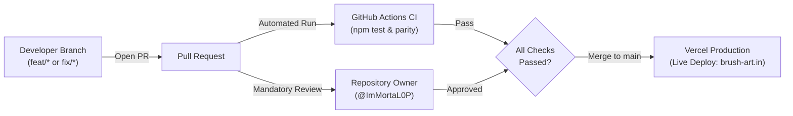
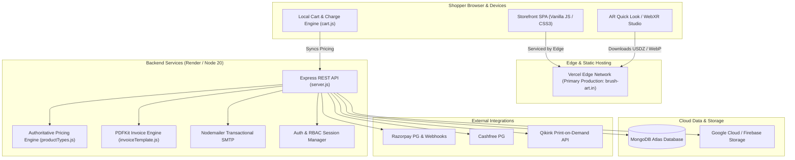

# Brush — Premium Poster & Wall Art E-Commerce Platform

<div align="center">


<br/>


<br/><br/>

**Transform your living space into art — Museum-grade wall decor, art prints, tapestries, wallpapers, apparel, and interactive AR shopping experiences.**

[](https://vercel.com/)
[](https://nodejs.org/)
[](https://expressjs.com/)
[](https://www.mongodb.com/atlas)
[](.github/workflows/ci.yml)
[](CONTRIBUTING.md)
[](https://developer.apple.com/augmented-reality/quick-look/)

[Live Storefront](https://www.brush-art.in) • [Shop Catalog](https://www.brush-art.in/shop/) • [Poster Reels](https://www.brush-art.in/reels/) • [Build a Pack](https://www.brush-art.in/build-pack/) • [Contributing Guidelines](CONTRIBUTING.md) • [Developer Manual](DEVELOPER.md)

</div>

---

## 🌟 Overview

**Brush** is an e-commerce platform engineered specifically for art prints and home decor. Designed with a decoupled architecture, Brush combines a zero-framework, lightning-fast static frontend with an Express API backend and MongoDB Atlas cluster.

The platform goes beyond conventional grid shopping by offering rich visual experiences:
- **Instagram/TikTok-style Poster Reels** with instant double-tap cart additions.
- **Augmented Reality (AR) & 3D Wall Studio** to view artwork at physical scale on real walls via Apple AR Quick Look and WebXR.
- **Interactive Multi-Pack Builder** allowing shoppers to curate custom gallery wall sets (3, 5, 10, 15, 20, 25 prints) with dynamic tier discounting.
- **Enterprise-grade fulfillment pipeline** integrated directly with Qikink Print-on-Demand, Razorpay, Cashfree, and Nodemailer.

---

## 🔒 Branch Protection & Deployment Governance

To ensure maximum uptime and prevent untested code from reaching production, this repository enforces strict branch governance:



1. **No Direct Pushes to `main`**: Direct push access to `main` is restricted. All changes must be proposed via feature branches (`feat/`, `fix/`) through Pull Requests.
2. **Mandatory Code Owner Approval**: Configured via [`.github/CODEOWNERS`](.github/CODEOWNERS). All pull requests require formal review and approval from **@ImMortaL0P** before merging is allowed.
3. **Automated CI Quality Gates**: Every pull request triggers [`.github/workflows/ci.yml`](.github/workflows/ci.yml) to verify pricing parity, cart invariants, and AR contract requirements before code can be merged.
4. **Isolated Vercel Preview Environments**: Pull requests generate dedicated preview deployment URLs for visual QA without altering the live production store.

---

## 🚀 Key Highlights & Features

| Capability | Details |
| :--- | :--- |
| **Storefront Performance** | Pure Vanilla HTML5, CSS3, and ES6+ JavaScript. No bloated client frameworks. Over **2,200 WebP derivatives** pre-generated with Gzip & Brotli static precompression. |
| **Augmented Reality & 3D Studio** | Native Apple Quick Look (`.usdz`) for iOS Safari + genuine WebXR vertical-wall hit testing for supported Android devices + 3D Canvas Studio fallback. |
| **Curated Multi-Poster Packs** | Dynamic bundle builder (`/build-pack/`) for 3, 5, 10, 15, 20, and 25-poster gallery sets with instant preview and gallery frame customization. |
| **Multi-Product Engine** | Native support for Posters (A5 to 13×19″, multiple paper GSMs, Matte/Glossy, Framed/Unframed), T-Shirts, Hoodies, Tapestries, Metal Prints, Wallpaper rolls, and Digital Downloads. |
| **Dual Payment Gateways** | Multi-gateway checkout powered by **Razorpay** and **Cashfree** (UPI, Credit/Debit Cards, Net Banking) plus Direct UPI Intent & Cash on Delivery (COD). |
| **Dropshipping Fulfillment** | Automated print-on-demand fulfillment API integration with **Qikink**, complete with automated SKU mapping and diagnostic endpoints. |
| **Role-Based Admin Portal** | Dedicated admin suite (`/admin/`) with role-based access control (`superadmin`, `stocker`, `watcher`), live stock adjustments, automated PDF invoice generation, and audit logging. |
| **SEO & Crawlability** | Standalone pre-rendered product landing pages (`/p/<id>-<slug>/`), collections, Open Graph tags, Breadcrumb JSON-LD, image sitemaps, and strict clean routing. |

---

## 📐 System Architecture



---

## 📂 Project Structure

```
Brush-Production/
├── .github/                       # GitHub repository governance & CI
│   ├── CODEOWNERS                 # Mandatory PR review rule (assigned to @ImMortaL0P)
│   ├── pull_request_template.md   # Structured pull request verification checklist
│   └── workflows/
│       ├── ci.yml                 # Automated parity & contract test gate on PRs
│       └── keepalive-render.yml   # 10-minute warm-window cron pinger for Render backend
├── Backend/                       # Node.js + Express API server (~3,400 LOC)
│   ├── server.js                  # Main server entry point & 44 REST endpoints
│   ├── productTypes.js            # Authoritative pricing & variant calculation engine
│   ├── qikink.js                  # Qikink Print-on-Demand API integration client
│   ├── qikink-map.js              # SKU & print variant mapping dictionary
│   ├── invoiceTemplate.js         # Automated PDF invoice generator (PDFKit)
│   ├── orderEmailTemplate.js      # Responsive HTML/Plain-text transactional emails
│   ├── setupAdmin.js              # Interactive CLI for admin account provisioning
│   ├── compress_images.py         # Pillow image optimizer for backend assets
│   ├── tests/                     # Test suites (charges parity, AR contracts)
│   └── scripts/                   # Catalog migrations & maintenance scripts
├── public/                        # Static frontend storefront
│   ├── index.html                 # Flagship homepage
│   ├── all_products.html          # Dynamic catalog with faceted filters (/shop/)
│   ├── poster-reels.html          # Vertical swipeable poster reels (/reels/)
│   ├── build-pack.html            # Curated gallery pack builder (/build-pack/)
│   ├── digital-assets.html        # High-resolution digital downloads (/buy-digital-assets/)
│   ├── checkout.html              # Multi-step checkout pipeline (/checkout/)
│   ├── order-confirmation.html    # Order tracking & PDF download (/order-confirmation/)
│   ├── admin.html                 # Role-based admin portal (/admin/)
│   ├── ar-view.js                 # Apple AR Quick Look + WebXR 3D Studio engine
│   ├── cart.js                    # Client-side cart manager & mirrored pricing rules
│   ├── store.js                   # Store catalog controller, URL state & faceted search
│   ├── script.js                  # Core storefront logic, auth modals & toasts
│   ├── theme.js                   # Instant zero-FOUC dark/light theme switcher
│   ├── scroll.js                  # Lenis smooth-scrolling engine
│   ├── micro-interactions.js      # Cursor follower physics & magnetic buttons
│   ├── img-utils.js               # Responsive WebP thumbnail resolver (w480 / w1080)
│   ├── styles.css                 # Global design system & token definitions
│   ├── img/                       # Responsive optimized WebP derivatives (w480, w1080)
│   ├── assets/                    # Product media split across 22 catalog categories
│   ├── posters/                   # Master artwork for poster prints & gallery packs
│   └── Fonts/                     # Self-hosted typography (woff2, woff, otf, ttf)
├── stickers/                      # Vector SVGs, printable PNGs, and ZIP packs
├── tools/                         # Build, optimization, precompression & SEO tools
│   ├── build-pages-site.js        # Clean-route generator & Gzip/Brotli precompressor
│   ├── audit-pages.js             # Automated SEO route validator & link auditor
│   ├── make-thumbs.py             # Python PIL multi-tier WebP generator (w480, w1080)
│   ├── generate-all-thumbnails.js # Native cwebp thumbnail pipeline
│   ├── sync-cart-config.py        # Synchronizer between server pricing & client cart
│   └── site-config.js             # Canonical origin & URL definitions
├── vercel.json                    # Vercel build command, clean 301 redirects & cache headers
├── keepalive.sh                   # Local/daemon shell script for Render keepalive
├── CONTRIBUTING.md                # Contributing guidelines & PR workflow
├── DEVELOPER.md                   # Complete exhaustive technical manual
└── package.json                   # Root package scripts and test commands
```

---

## 🛠️ Tech Stack Matrix

| Layer | Technologies |
| :--- | :--- |
| **Frontend Core** | HTML5, Modern CSS3 (Variables, Grid, Flexbox, BEM), Vanilla JavaScript (ES6+ Modules, IIFE) |
| **Motion & UX** | [Lenis](https://github.com/darkroomengineering/lenis) (Smooth Scroll), Canvas Micro-physics, CSS Keyframes |
| **3D & AR** | Apple AR Quick Look (`model/vnd.usdz+zip`), WebXR Device API (`immersive-ar`), WebGL 3D Studio |
| **Backend Framework** | Node.js (v20.x), Express.js (v4.18.2) |
| **Database** | MongoDB Atlas (Native driver `mongodb` v7.5.0) |
| **File Storage** | Google Cloud Storage / Firebase Admin SDK (`firebase-admin` v14.2) |
| **Security & Headers** | Helmet (`helmet` v8.3), Express Rate Limit (v8.6), Bcrypt.js (v3.0) |
| **Invoicing & Mail** | PDFKit (v0.19.1), Nodemailer (v10.0.9) with Resend/SMTP integration |
| **Payment Gateways** | Razorpay (v2.9.8), Cashfree PG (v6.0.6), Direct UPI QR Intent |
| **Fulfillment** | Qikink Print-on-Demand REST API |
| **Image Pipelines** | Python 3 + Pillow (PIL), Google `cwebp`, Node.js native `zlib` (Brotli & Gzip) |
| **Hosting & CI/CD** | Vercel Edge Network (`brush-art.in`), GitHub Actions CI, Render Web Services |

---

## ⚡ Quickstart & Local Development

### Prerequisites

- **Node.js**: `v20.x` or higher
- **Python**: `3.9+` with `Pillow` (for thumbnail generation and asset tooling)
- **MongoDB**: MongoDB Atlas connection string or local MongoDB instance

### 1. Clone & Install Dependencies

```bash
git clone https://github.com/ImMortaL0P/Brush-Production.git
cd Brush-Production

# Install Backend dependencies
cd Backend
npm install
cd ..
```

### 2. Configure Environment Variables

Create a `.env` file in the `Backend/` directory:

```bash
cp Backend/.env.example Backend/.env
```

Fill in your configuration:
```ini
PORT=5500
SITE_URL=http://localhost:3000
MONGODB_URI=mongodb+srv://<user>:<password>@cluster.mongodb.net/brush?retryWrites=true&w=majority

# Razorpay (optional for dev, mock payments supported)
RAZORPAY_KEY_ID=rzp_test_xxxxxxx
RAZORPAY_KEY_SECRET=xxxxxxx
ALLOW_MOCK_PAYMENTS=true

# Firebase (optional in local dev with SKIP_FIREBASE=true)
FIREBASE_STORAGE_BUCKET=your-app.appspot.com

# SMTP Email Configuration
SMTP_HOST=smtp.resend.com
SMTP_PORT=465
SMTP_USER=resend
SMTP_PASS=re_xxxxxxx
EMAIL_FROM="Brush" <orders@yourdomain.com>
```

### 3. Start the Backend API

```bash
npm run dev:backend
# Starts Express server on port 5500 with SKIP_FIREBASE=true
```

### 4. Start the Frontend

In a separate terminal window:

```bash
npm run dev:frontend
# Serves public/ on http://localhost:3000 with cache disabled
```

Visit [`http://localhost:3000`](http://localhost:3000) in your browser.

### 5. Provision an Admin Account

```bash
cd Backend
npm run setup-admin
```

---

## 🧪 Testing & Quality Assurance

Brush enforces automated parity tests between client and server pricing engines, as well as contractual AR parameter tests:

```bash
# Run all unit and parity test suites
npm test
```

Test coverage includes:
1. **Charges Parity Test (`Backend/tests/charges-parity.js`)**: Evaluates 20+ cart combinations (single posters, 20-packs, apparel, framed posters, express shipping, coupon discounts, COD surcharges) inside a headless VM, guaranteeing that `Backend/productTypes.js` and `public/cart.js` calculate identical amounts to the cent.
2. **AR Contract Test (`Backend/tests/ar-poster-contract.js`)**: Validates physical metric aspect ratios, Quick Look USDZ attributes, and vertical plane anchoring rules.
3. **SEO Route Audit (`tools/audit-pages.js`)**: Executed automatically during builds to ensure single H1 tags, canonical tags, Open Graph tags, JSON-LD schemas, and no broken legacy links exist on deployed routes.

---

## 🚢 Production Deployment

### Frontend (Vercel Edge Platform)

Production storefront hosting is powered directly by **Vercel**:
- **Configuration**: [`vercel.json`](vercel.json)
- **Automated Build & Audit Pipeline**:
  ```bash
  node tools/build-pages-site.js .pages-site && node tools/audit-pages.js .pages-site
  ```
  Vercel automatically compiles clean route directories, precompresses static files with Brotli and Gzip, and verifies that the SEO route audit passes before shipping the deployment.
- **Edge Routing & Performance**:
  - 301 permanent redirects for all legacy `.html` routes.
  - 1-year immutable caching on static assets (`/img/`, `/assets/`, `/posters/`, `/Fonts/`).
  - Stale-while-revalidate caching on dynamic scripts and stylesheets.
  - Enterprise security headers (HSTS, CSP, nosniff, frameguard, COOP).

### Backend (Render Web Service)

- Hosted on **Render** (Node 20 environment).
- Keepalive architecture: To eliminate cold starts during active shopping hours:
  - **Shell Script (`keepalive.sh`)**: Health pings every 10 minutes between 08:00 AM and 05:00 AM IST.
  - **GitHub Actions Scheduled Ping ([`.github/workflows/keepalive-render.yml`](.github/workflows/keepalive-render.yml))**: Automated workflow pinging `/api/health` every 10 minutes.

---

## 📖 Deep Technical Documentation

For an exhaustive technical breakdown covering:
- In-depth compression mechanisms (Gzip, Brotli, WebP, USDZ)
- Complete directory structure and file-by-file annotated reference
- Full API endpoint documentation (44 endpoints)
- Role-based admin architecture & audit logging
- Dropshipping and payment gateway integration details
- Database schemas & indexes

👉 Please consult [**DEVELOPER.md**](DEVELOPER.md).

---

## 📄 License

Proprietary. All rights reserved © Brush Art.
Unauthorized copying, modification, distribution, or commercial use without written permission is strictly prohibited.
